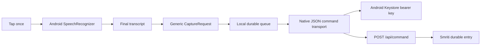
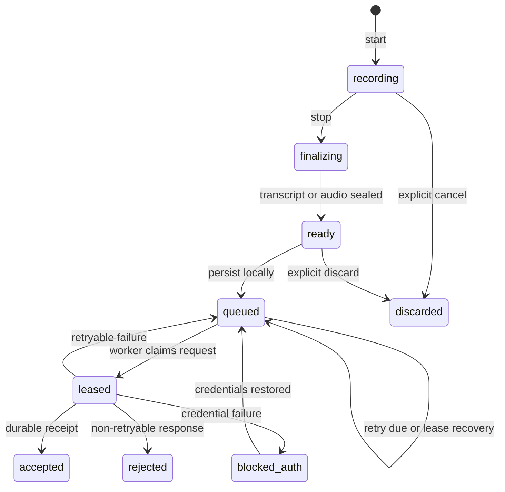

# Shruti architecture

## Purpose and boundary

Shruti is a capture pipe. It turns a spoken thought, shared text, or future platform ingress into one generic `CaptureRequest`, persists it locally, and hands it to a backend adapter. It does not manage notes, AI, organization, search, reminders, or any backend business concept.

The Smriti adapter maps a generic capture to a Smriti command. The generic JSON transport owns delivery and credentials, not journal behavior.

## Current Android test topology



The Android adapters are intentionally small:

- `ShrutiSpeechRecognition` owns Android runtime microphone permission and final speech recognition.
- `ShrutiCommandTransport` owns the API key and native JSON HTTP delivery.
- ClojureScript owns generic request state, retry rules, the local browser/WebView fallback queue, and the single-action UI.

The native transport avoids a cross-origin WebView request, so Smriti does not need browser CORS headers for this app.

## Core domain model

`CaptureRequest` is versioned and generic. Delivery state belongs in `:local` and never travels to the backend.

```clojure
{:schema-version 1
 :id "client-generated-uuid"
 :occurred-at "2026-09-08T12:34:56.000Z"
 :source {:kind :voice :entrypoint :app :platform :android}
 :content {:type :text
           :text "Remember that we need 20kg potatoes tomorrow."
           :transcript "Remember that we need 20kg potatoes tomorrow."
           :audio nil}
 :locale "en-IN"
 :tags []
 :metadata {:client "shruti-android"}
 :local {:content-state :ready
         :delivery {:state :queued
                    :retry-count 0
                    :next-at-ms 0
                    :lease nil
                    :last-error nil
                    :receipt nil}}}
```

The stable UUID is allocated before capture begins and retained across retries. Smriti deduplicates it per User.

## State machine

Content and delivery are separate axes.



Invariants:

- A voice capture can finalize as transcript-only, audio-only, or audio-plus-transcript.
- A request is not eligible for delivery until its content is ready and locally persisted.
- A successful receipt is committed before any associated local media can be cleaned up.
- Credentials are not part of a request, media metadata, or shared UI state.

## Data flow

1. A platform source creates a normalized `CaptureInput`.
2. Shared intake allocates a UUID and persists a recording-state request.
3. The Android speech adapter produces a final transcript when the user stops.
4. The request becomes transcript-only `:text`, ready, and queued in one local update.
5. Sync claims due captures, requests opaque auth material, and asks the configured transport to deliver.
6. The native Smriti adapter creates multipart fields: `transcription`, `recordedAt`, `client`, and `captureId`.
7. A `2xx` result becomes an acceptance receipt; retryable failures retain the queued request.

Future sources—share sheet, widget, shortcut, tile, URL, App Intent, App Action, accessory—must enter at step 1. They do not get another request schema or another backend route.

## Folder and namespace layout

```text
shruti/
  android/                         Capacitor host plus Android adapters
  ios/                             Generated Capacitor host
  docs/                            Architecture, backend and platform records
  packages/capacitor-shruti-bridge/ Future durable native bridge contract
  public/                          Minimal WebView shell
  scripts/                         Android device checks and install commands
  src/main/shruti/
    domain/capture.cljs            Pure request and state rules
    application/                   Intake, sync, replaceable ports
    infra/                         Browser, Android-bridge, and command adapters
    ui/root.cljs                   One-action UI and one-time setup
    composition.cljs               Explicit dependency assembly
  src/test/shruti/                 Domain and transport contract tests
```

| Layer | Namespaces | May depend on |
| --- | --- | --- |
| Domain | `shruti.domain.capture` | ClojureScript standard library |
| Application | `shruti.application.intake`, `sync`, `ports` | Domain and ports |
| Infrastructure | `shruti.infra.*` | Domain and application ports |
| UI | `shruti.ui.root` | Application functions and explicit system map |
| Composition | `shruti.composition` | Infrastructure implementations |

No domain namespace imports Android, Capacitor, HTTP, database, Smriti, or UI code. The composition root selects adapters explicitly instead of using a singleton service locator.

## Platform abstraction and native strategy

The important replacement seams are plain-data protocols:

```clojure
(defprotocol CaptureStore
  (put-capture! [store capture])
  (get-capture! [store capture-id])
  (list-captures! [store])
  (put-media! [store asset-id blob])
  (get-media! [store asset-id])
  (delete-media! [store asset-id]))

(defprotocol VoiceCapture
  (start! [capture options])
  (stop! [capture])
  (cancel! [capture]))

(defprotocol CaptureTransport
  (deliver! [transport capture media request-auth]))

(defprotocol DeliveryConfiguration
  (delivery-status! [configuration])
  (configure-delivery! [configuration options])
  (clear-delivery! [configuration]))
```

Android's two current Capacitor plugins are adapters, not domain services:

| Plugin | Responsibility | Does not own |
| --- | --- | --- |
| `ShrutiSpeechRecognition` | Permission, `SpeechRecognizer`, final transcript lifecycle | Capture meaning, queue policy, API key |
| `ShrutiCommandTransport` | HTTPS validation, AndroidKeyStore secret, JSON HTTP | Transcript mapping, queue policy, Smriti business logic |

The package in `packages/capacitor-shruti-bridge` remains the planned contract for durable platform ingress, private files, SQLite, and background scheduling. The current Android phone path is a thin testable slice, not the finished native reliability layer.

## Offline synchronization and reliability

The shared implementation persists the request before delivery, recovers expired leases, retains rejected captures, and uses capped exponential full-jitter retry with `Retry-After` support. The browser/WebView development store is IndexedDB.

What is already true:

- A capture is queued locally before delivery is attempted.
- Network failures, `408`, `425`, `429`, and `5xx` stay retryable.
- `401` and `403` do not spin in a network retry loop.
- The API key is not stored in the queue.

What remains before a production reliability claim:

- Replace IndexedDB on device with app-private SQLite plus file references.
- Add native background delivery (`WorkManager` on Android and background `URLSession` on iOS).
- Add crash-safe native ingress for widget, share, shortcut, and tile sources.

## Audio and transcription

The Android test slice uses the platform speech recognizer and sends its final transcript to Smriti. It intentionally does not retain or upload speech audio.

The domain keeps audio opaque so later adapters can swap in:

| Layer | First production choice | Replace when needed |
| --- | --- | --- |
| Android audio | App-private AAC/M4A via `MediaRecorder` | `AudioRecord` for VAD, PCM, streaming |
| iOS audio | App Group AAC/M4A via `AVAudioRecorder` | `AVAudioEngine` for levels and streaming |
| Transcription | Android Speech / Apple Speech / backend service adapter | Cloud or local Whisper, OpenAI, Gemini, streaming |
| Shared model | Audio reference plus optional transcript | Unchanged |

A later audio-capable Smriti endpoint can be another transport adapter; the local `CaptureRequest` schema does not need to change.

## Transport and security

The exact current backend contract is documented in [api-contract.md](api-contract.md).

- Only the Smriti adapter maps captures to Smriti command fields.
- Android validates HTTPS and rejects query/user-info before saving configuration.
- The bearer token is AES-GCM encrypted under AndroidKeyStore, excluded from Android backup, and never returned to JavaScript.
- Native HTTP uses bounded response bodies, avoids redirects, and redacts the bearer token if it appears in a response body.

## Testing strategy

1. Pure domain tests cover content/delivery transitions, manifest stripping, and retry boundaries.
2. Transport contract tests assert the exact Smriti field mapping and response classification.
3. Native unit/instrumentation tests should cover Keystore invalidation, URL validation, HTTP status mapping, speech permission denial, no-match, and lifecycle teardown.
4. Device smoke tests cover first-time key setup, microphone permission, transcript display, offline retry, invalid key, and a successful Smriti entry.
5. Production native-outbox work adds crash/restart, background scheduler, file sealing, widget, share, and concurrency coverage.

## Build and phone test

See [Android device testing](android-device-testing.md). The short path is:

```sh
npm install
npm run android:doctor
npm run android:install
```

The phone receives a build with no bundled API key. The setup screen takes a Smriti server host and appends the fixed `/api/command` path, which is displayed as a label; only the host and API key are editable. The native plugin stores the key in Android Keystore. Existing Pebble connections must be configured again.

## Roadmap

1. Finish the Android test slice: validate the real phone flow and add native tests.
2. Replace the WebView store with Android SQLite, private media, and `WorkManager`.
3. Add Android share text, dynamic shortcut, widget, Quick Settings tile, and notification re-entry through the same inbox.
4. Build iOS App Group ingress, Share Extension, App Shortcuts, and background delivery.
5. Add audio assets, silence detection, streaming, and alternate transcription only when the backend contract can accept them.
